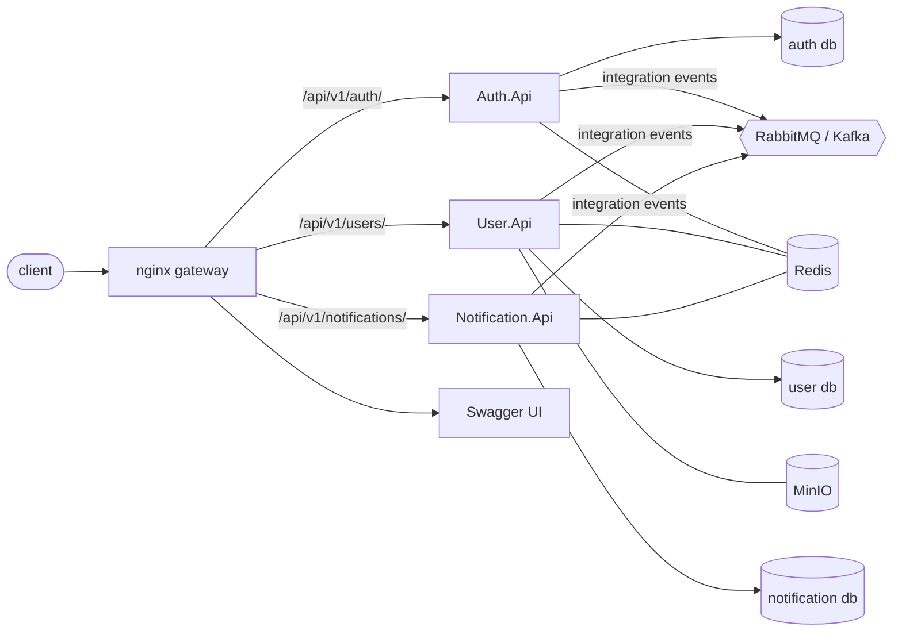

# Architecture

What exists today, checked against the code. All three services build in CI and have unit and integration tests. The full compose stack has not been smoke-tested with real service containers.

## Services
| Service | Does | Layers |
|---|---|---|
| `OmniCore.Services.Auth` | accounts (register, login, logout, refresh token, current user), roles, JWT issuing (a Google token validator exists but no endpoint uses it yet) | Api / Application / Domain / Infrastructure / Contracts |
| `OmniCore.Services.User` | user profiles (+ avatar upload), settings, addresses, tenant profiles (`UserTenantProfile`); Carter endpoints, EF Core DbContext, repository and initial migration (ADR 0004) | same five layers |
| `OmniCore.Services.Notification` | e-mail delivery with templates, retries, deduplication and an admin delivery log; consumes Auth's `AccountRegisteredIntegrationEvent` and `NotificationRequestedIntegrationEvent`; Carter endpoints, EF Core initial migration | same five layers |
| `OmniCore.Shared` | DDD base types, value objects, repository + query contracts, MediatR behaviours, EF Core / MassTransit / Redis / S3 wiring, JWT validation and rate limiting extensions, integration-event contracts | Domain / Application / Infrastructure / Api / Contracts |

Each service owns its PostgreSQL database (`AUTH_DB_NAME`, `USER_DB_NAME`, `NOTIFICATION_DB_NAME`, created by
`infra/docker/scripts/init-dbs.sql`). `scripts/shells/scaffold_service.ps1` generates a service with the same five layers.
The solution (`OmniCore.slnx`) lists 30 projects, including unit and integration test projects.

## Request path
client -> nginx gateway (`infra/docker/nginx/nginx.conf`, prefix routing, one block per service) -> service `.Api`
(Carter endpoints) -> MediatR command/query (pipeline behaviours) -> domain -> EF Core. Auth issues RS256 JWTs with a
JWKS endpoint; HS256 with `Jwt__Secret` stays as a legacy mode until cut-over ([ADR 0003](decisions/0003-auth-token-hardening.md)).
Each service validates tokens. The gateway routes `/api/v1/auth/`, `/api/v1/users/` and `/api/v1/notifications/` with
their specs, and applies per-IP rate limits ([ADR 0002](decisions/0002-gateway-auth-and-rate-limits.md)).

## Messaging
Integration events (`Shared.Contracts`) go through MassTransit. `MessageBroker__Provider` is `RabbitMQ` or `Kafka`
(default `RabbitMQ`; the value `Both` is **rejected** at startup, and the compose default was changed from `Both`). The outbox is the **MassTransit EF Core outbox**
(`AddEntityFrameworkOutbox` + `UseBusOutbox`, switched by `MessageBroker__EnableOutbox`, default on); the comment in
`MessageBrokerConfig` says it only applies to the RabbitMQ provider. The older hand-written outbox/inbox was removed;
`IOutboxService` remains as an abstraction. Redis is the distributed cache, MinIO is object storage. Every integration event, with its publisher, consumers, fields and secret handling, is catalogued in [events.md](events.md).

## Runtime layout (`infra/docker`)
`docker-compose.yml` includes `database` (postgres:17), `infra` (RabbitMQ, Redis, MinIO, Kafka + Kafka UI),
`services` (auth-api, user-api, notification-api) and `gateway` (nginx + Swagger UI). The service images run as a non-root user
(`appuser`) and have `/health` and compose health checks. Swagger specs are aggregated through the gateway
(`/specs/<name>.json`, `SWAGGER_URLS`).
