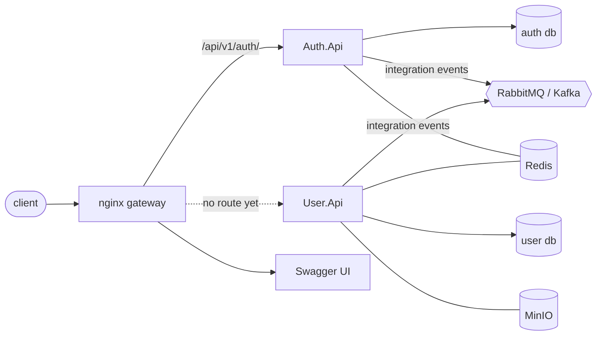

# Architecture

What exists today, checked against the code. **Not built or run**: no .NET SDK was available for the check.

## Services
| Service | Does | Layers |
|---|---|---|
| `OmniCore.Services.Auth` | accounts (register, login, logout, refresh token, current user), roles, JWT issuing, Google sign-in | Api / Application / Domain / Infrastructure / Contracts |
| `OmniCore.Services.User` | user profiles (+ avatar upload), settings, tenant profiles (`UserTenantProfile`) | same five layers |
| `OmniCore.Shared` | DDD base types, value objects, repository + query contracts, MediatR behaviours, EF Core / MassTransit / Redis / S3 wiring, JWT validation and rate limiting extensions, integration-event contracts | Domain / Application / Infrastructure / Api / Contracts |

Each service owns its PostgreSQL database (`AUTH_DB_NAME`, `USER_DB_NAME`, created by
`infra/docker/scripts/init-dbs.sql`). `scripts/shells/scaffold_service.ps1` generates a service with the same five layers.
The solution (`OmniCore.slnx`) lists the 15 projects; it has no test project.

## Request path
client -> nginx gateway (`infra/docker/nginx/nginx.conf`, prefix routing, one block per service) -> service `.Api`
(Carter endpoints) -> MediatR command/query (pipeline behaviours) -> domain -> EF Core. Auth issues JWTs signed with
one shared symmetric key (`Jwt__Secret`, HS256); every other service validates them with the same secret, issuer and
audience. Today the gateway routes only `/api/v1/auth/` and `/specs/auth.json`.

## Messaging
Integration events (`Shared.Contracts`) go through MassTransit. `MessageBroker__Provider` is `RabbitMQ` or `Kafka` in
code (default `RabbitMQ`) but the compose file defaults it to `Both`. The outbox is the **MassTransit EF Core outbox**
(`AddEntityFrameworkOutbox` + `UseBusOutbox`, switched by `MessageBroker__EnableOutbox`, default on); the comment in
`MessageBrokerConfig` says it only applies to the RabbitMQ provider. The older hand-written outbox/inbox was removed;
`IOutboxService` remains as an abstraction. Redis is the distributed cache, MinIO is object storage.

## Runtime layout (`infra/docker`)
`docker-compose.yml` includes `database` (postgres:17), `infra` (RabbitMQ, Redis, MinIO, Kafka + Kafka UI),
`services` (auth-api, user-api) and `gateway` (nginx + Swagger UI). The service images run as a non-root user
(`appuser`) and have `/health` and compose health checks. Swagger specs are aggregated through the gateway
(`/specs/<name>.json`, `SWAGGER_URLS`).
