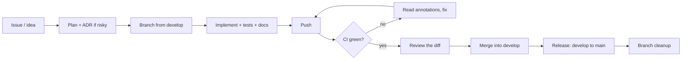

# Workflow: from idea to `main`

One page that says who does what, in which order. Details live in the linked docs. Applies to the owner, friends who
contribute, Claude sessions and the OpenCode junior agent alike.

## At a glance

| Step | Who | Output | Gate to the next step |
|---|---|---|---|
| 1. Issue | owner or anyone | a task issue (what and why) | scope is clear |
| 2. Plan (+ ADR) | author (Claude or a human) | `docs/plans/NNNN-title.md`; ADR first if risky | owner OK for non-routine scope |
| 3. Branch | author | `feat/<x>`, `fix/<x>`, `docs/<x>` from `develop`; OpenCode makes `opencode/<role>-<task>-<run>` | never commit on `main` |
| 4. Implement | author | code + tests + docs in small commits | tests added, none weakened |
| 5. Push and CI | author | green `backend` / `frontend` run | only `completed` + `success` counts |
| 6. Review | someone other than the author (OpenCode work: Claude or owner, line by line) | approved diff | green CI is necessary, not enough |
| 7. Merge | owner (or Claude on request) | `--no-ff` merge or PR into `develop` | CI green on the merge result |
| 8. Release | owner asks, then `develop` is merged to `main` | CI on `main` | CI green on `main` |
| 9. Cleanup | automatic | merged branches deleted weekly | n/a |

## 1. Issue
Small, one outcome per issue. Junior tasks are issues too (`/oc <role>: <task>` comment, see [opencode.md](opencode.md)).

## 2. Plan first
Every non-trivial change starts with a Markdown plan; trivial fixes (typo, broken link) skip the file but still update the docs they invalidate.

1. Read `CLAUDE.md`, `docs/architecture.md`, the service/layer `README.md`, `docs/roadmap.md`, `docs/repo-check.md`.
2. Add `docs/plans/NNNN-short-title.md` from the template in [plans/README.md](plans/README.md): problem, scope, non-goals, files, tests, docs, risks, CI jobs it should trigger.
3. Risky change (schema, token format, rename, new service, new dependency): write the ADR first in `docs/decisions/`. The plan links the ADR; the ADR holds the decision.
4. One plan per area at a time; update the plan before the code when scope changes.

## 3. Branches
- `main`: released state. `develop`: working branch, where everything is merged first. Both are long-lived and never deleted.
- Short-lived branches start from `develop`: `feat/<what>`, `fix/<what>`, `docs/<what>`. Names say what the branch is for.
- OpenCode branches are `opencode/<role>-<task-slug>-<run id>`.
- Merged branches are deleted by `branch-cleanup.yml` (weekly; also tick "Automatically delete head branches" in repo settings).
- Commit style: `docs:`, `feat(auth):`, `fix(auth):`, `refactor(shared):`, `ci:`, `test:`. Small and reviewable.

## 4. Implement
- Tests with the code; never weaken or skip a test to get green.
- Docs are part of the change: affected READMEs, `architecture.md`, `roadmap.md`, `repo-check.md`, `CLAUDE.md` progress lines, the ADR, the plan status. A change is not done while its docs describe the old behaviour.
- Migrations are in the same commit as the entity change (and the snapshot test must stay green).
- Never commit secrets; examples use `CHANGE_ME`.

## 5. Push and CI
Agent sessions have no NuGet access, so GitHub Actions builds. Rules (details: [ci-cd.md](ci-cd.md)):
- Say "CI green" only after seeing a `completed` + `success` run (or the developer reporting it). Otherwise "pushed, CI awaited".
- `auto` mode (current): the agent checks once per push after other useful work, reads failures from annotations, fixes and pushes. `manual`: push and stop.
- A `cancelled` run is not a failure: re-run it (a newer push in the same branch cancels the older run).

## 6. Review
- The author never reviews alone. Humans and Claude read the diff line by line.
- OpenCode output is a draft: check the diff, the report and the branch CI. A comment on the issue says when CI finished ("ready for review" / "needs a fix").
- Check every new endpoint for `RequireAuthorization()` / roles, and that tenant and caller ids come from the token.

## 7. Merge into `develop`
`git merge --no-ff` (OpenCode branches) or a PR into `develop`. Update `CLAUDE.md` progress after the merge.

## 8. Release to `main`
Only when the owner asks. Merge `develop` into `main`, confirm CI on `main`. With branch protection on, this goes through a PR that needs `ci-gate`.

## Roles
| Who | Does | Does not |
|---|---|---|
| Owner | decides scope, accepts ADRs, merges and releases, repo settings, secrets and keys | |
| Claude | plans, ADRs, cross-cutting or risky code (tenancy, migrations, auth), reviews OpenCode branches, CI follow-up | push to `main` without being asked; claim unbuilt code works |
| OpenCode | small, well-specified tasks (docs, schemas, tests, simple features) | touch `.github/`, `CLAUDE.md`, secrets, prod compose |
| Friends | feature/fix branches and PRs into `develop` (collaborator access) | push to `main` or `develop` directly |

## Definition of done
Code and tests written, docs and plan updated, CI green on the branch, diff reviewed by someone else, merged into `develop`, `CLAUDE.md` progress line added.

## Skill
The repeatable parts of this page are also packaged as a Claude skill (`omnicore-workflow`) so a new session follows the same sequence.
